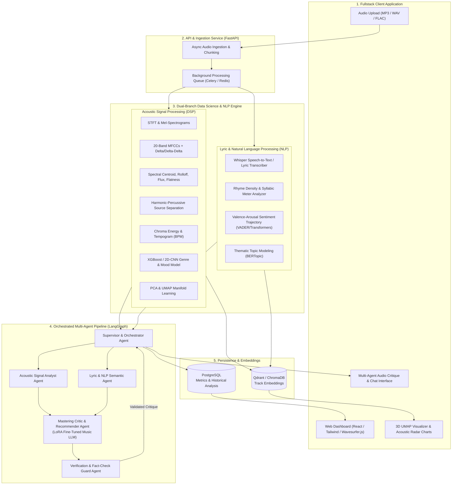
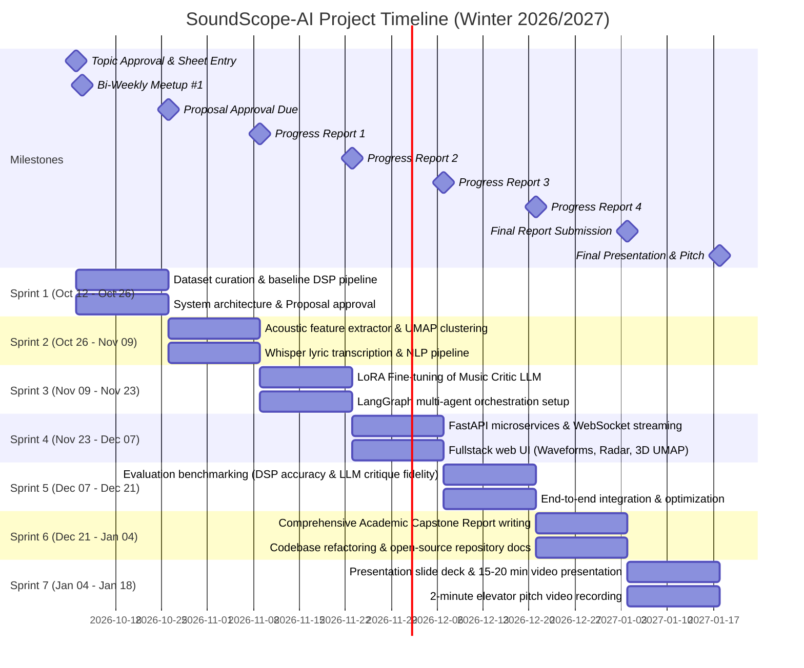

# SoundScope-AI: Multi-Agent Acoustic & Lyric Intelligence Platform
**Data Science & Applied AI Capstone Project — Winter 2026/2027**  
**University of Europe for Applied Sciences (UE)**  
**Supervisor:** Dr. Humera Noor  

---

## 1. Project Overview

- **Authors:** Alok Sali (Matriculation No: 46854973) & Apoorv Pillai (Matriculation No: 85099328)
- **Degree Program:** M.Sc. Data Science
- **Institution:** University of Europe for Applied Sciences (UE)
- **Module:** DSC03 Capstone Project B (Winter 2026/2027)
- **Live Project Announcement:** [LinkedIn Milestone 2 Post](https://lnkd.in/p/dK-aYDwb)
- **Lecture Tracks Addressed (Directly covering the Capstone Lecture tracks):**
  - **Agent Pipelines:** Orchestrated multi-agent workflow (LangGraph) coordinating specialized signal, lyric, and mastering agents with reflection loops.
  - **LLM Fine-Tuning:** Domain adaptation (LoRA / QLoRA) on open-weight LLMs (Llama-3 / Qwen2.5) specialized in music theory, production critique, and acoustic feedback.
  - **Natural Language Processing (NLP):** Lyric semantic extraction, rhyme density analysis, emotional valence-arousal arcs, and thematic topic modeling.
  - **Data Science & ML:** Digital Signal Processing (DSP), mathematical feature engineering (MFCCs, spectral moments, HPSS), manifold learning (PCA, UMAP), and multi-class genre/mood classification (XGBoost vs. 2D-CNN).
  - **Software Development / API:** Asynchronous FastAPI microservices, background task queue for audio processing, WebSocket telemetry.
  - **Fullstack Application:** Interactive web platform featuring real-time audio playback, dynamic waveforms, 3D UMAP genre clusters, acoustic radar charts, and an interactive multi-agent chat critique panel.

---

## 2. Problem Statement & Motivation

Music is a multimodal medium combining acoustic signal physics (timbre, rhythm, frequency distribution) and textual poetry (lyrics, narrative progression, emotion). However, current music analytics platforms treat audio and lyrics in silos:
1. **Isolated Signal Analytics:** DSP and music information retrieval (MIR) tools output raw mathematical numbers (e.g., spectral centroid = 2400 Hz) with no contextual, human-interpretable meaning for artists.
2. **Superficial Lyric Processing:** Streaming algorithms rely on simplistic genre tags or metadata keywords, ignoring subtle linguistic metaphors, sentiment trajectories, and vocabulary richness.
3. **Black-Box Cold-Start Problem:** Independent musicians receive zero actionable feedback on why their mixes fail to engage listeners or which technical adjustments (compression, EQ balance, narrative cadence) would improve their tracks.

**SoundScope-AI** solves this by uniting **Acoustic Data Science** and **NLP** within an **Orchestrated Multi-Agent Architecture**. It processes uploaded audio tracks, transcribes and analyzes lyrics, extracts high-dimensional DSP acoustic fingerprints, and generates explainable, professional production critiques powered by a fine-tuned music intelligence LLM.

---

## 3. System Architecture

---

## 4. Multi-Agent Pipeline Roles & LLM Fine-Tuning

### The Four Cooperating Agents (LangGraph):
1. **Acoustic Signal Analyst Agent:** Ingests the mathematical DSP metrics (spectral balance, loudness range, dynamic contrast, tempo consistency) and translates them into acoustic engineering terms (e.g., *"excessive low-end muddiness below 200 Hz"*).
2. **Lyric & NLP Semantic Agent:** Evaluates narrative arc, rhyme density score, emotional dissonance (e.g., cheerful acoustic tempo paired with sorrowful lyrics), and lyrical themes.
3. **Mastering Critic & Recommender Agent:** Powered by a fine-tuned open LLM (Qwen2.5-7B / Llama-3-8B via LoRA), this agent synthesizes the acoustic metrics and lyric analysis into an expert-level production review with actionable EQ, arrangement, and lyrical suggestions.
4. **Verification & Fact-Check Guard Agent:** Verifies that LLM suggestions align with measured DSP metrics, preventing hallucinations.

### LLM Fine-Tuning Strategy:
- **Base Model:** `Qwen2.5-Coder / Llama-3-8B-Instruct`
- **Method:** Parameter-Efficient Fine-Tuning (PEFT) using **QLoRA (4-bit quantization)** with rank $r = 16$, $\alpha = 32$.
- **Training Corpus:** Curated dataset of professional mixing/mastering feedback, musicological analyses, and paired audio-lyric commentary.

---

## 5. Technical Stack

| Category | Technologies |
|---|---|
| **Agent Pipelines** | LangGraph, LangChain Core |
| **LLM Fine-Tuning** | Unsloth / PEFT, Hugging Face Transformers, BitsAndBytes |
| **NLP** | Whisper (Lyric Transcription), NLTK / Spacy, BERTopic, RoBERTa Sentiment |
| **Audio DSP & ML** | Librosa, Essentia, SciPy, Scikit-learn, XGBoost, PyTorch (2D-CNN) |
| **Dimensionality Reduction** | UMAP, t-SNE, PCA |
| **Backend & APIs** | FastAPI, Uvicorn, Celery, Redis |
| **Frontend Application** | React, Tailwind CSS, Wavesurfer.js, Plotly.js / Three.js (3D UMAP) |
| **Databases** | PostgreSQL (Metadata/logs), Qdrant / ChromaDB (Acoustic embeddings) |

---

## 6. Sprints & Timeline (Winter 2026/2027)

---

## 7. Quantitative Evaluation Metrics

1. **Acoustic & Classification Benchmarks:**
   - Multi-class Genre & Mood classification accuracy, Macro F1-score, and ROC-AUC on GTZAN and Free Music Archive (FMA).
   - UMAP/t-SNE cluster separation evaluated via Silhouette Coefficient and Davies-Bouldin Index.
2. **NLP & Lyric Benchmarks:**
   - Lyric transcription Word Error Rate (WER) using Whisper.
   - Sentiment trajectory coherence and topic classification precision.
3. **LLM Evaluation & Agent Benchmarks:**
   - Critique faithfulness and recommendation relevance scored via RAGAS / LLM-as-a-judge against human sound engineer annotations.
   - Hallucination rate (measuring if the agent claims acoustic issues not present in the DSP data).
4. **Performance & Latency:**
   - End-to-end processing latency for a 3-minute song (< 12 seconds on GPU).

---

## 8. Detailed Sprint Breakdown & Division of Responsibilities

While both authors maintain joint ownership of the end-to-end delivery, core technical leads are assigned to guarantee accountable, parallel execution:

| Sprint & Dates | Major Milestone | Primary Lead: Alok Sali | Primary Lead: Apoorv Pillai | Joint Deliverable |
|---|---|---|---|---|
| **Sprint 1** (Oct 12 – Oct 26) | Proposal Approval & Architecture Baseline | Audio dataset setup (FMA, GTZAN); baseline Librosa feature extraction pipeline | Lyric dataset curation (Genius/Spotify); Whisper baseline transcription test | Formal Proposal Document, System Architecture Diagram, University Form |
| **Sprint 2** (Oct 26 – Nov 09) | Progress Report 1: DSP & NLP Foundations | 20-band MFCC, HPSS, spectral flux/rolloff extractor; UMAP 2D/3D manifold projections | RoBERTa valence-arousal sentiment model; BERTopic lyrical topic clustering | Progress Report 1 & Individual LinkedIn Updates |
| **Sprint 3** (Nov 09 – Nov 23) | Progress Report 2: Models & Agent Core | Genre/Mood classifiers (XGBoost & 2D Mel-CNN); acoustic metric validation heuristics | LangGraph state graph setup; Signal Analyst Agent & Lyric Semantic Agent | Progress Report 2 & Individual LinkedIn Updates |
| **Sprint 4** (Nov 23 – Dec 07) | Progress Report 3: LLM Fine-Tuning & APIs | FastAPI ingestion service, async Celery audio worker queue, WebSocket telemetry | Music Critic LLM fine-tuning (QLoRA on Qwen2.5/Llama-3); prompt engineering & guardrails | Progress Report 3 & Individual LinkedIn Updates |
| **Sprint 5** (Dec 07 – Dec 21) | Progress Report 4: Integration & Fullstack UI | 3D UMAP interactive visualization, audio waveform player (Wavesurfer.js) | Multi-agent critique chat interface, radar charts, fullstack integration | Progress Report 4 & Individual LinkedIn Updates |
| **Sprint 6** (Dec 21 – Jan 04) | Final Capstone Submission | Quantitative benchmarking (F1, Silhouette, RAGAS critique fidelity); code refactoring | Capstone Academic Report drafting (Methodology, Literature Review, Discussion) | Comprehensive Capstone Report (PDF/Word), clean GitHub repository |
| **Sprint 7** (Jan 04 – Jan 18) | Final Presentation & Pitch | Presentation slide deck design; live demo recording | 15–20 min presentation video recording; 2-minute elevator pitch video | Final Slide Deck, Full Presentation Video, Elevator Pitch Video |

---

## 9. Risk Assessment & Mitigation Strategies

| Risk Factor | Probability | Impact | Mitigation Strategy |
|---|---|---|---|
| **GPU Compute Bottlenecks for LLM Fine-Tuning** | Medium | High | Utilize 4-bit QLoRA via Unsloth/BitsAndBytes to reduce VRAM requirements under 12GB (Google Colab T4/A100 or Kaggle GPU environments). |
| **Whisper Transcription Latency on Long Audio** | Medium | Medium | Implement chunked parallel audio processing and use `whisper-base` or `faster-whisper` (CTranslate2) for 4x inference speedup. |
| **LLM Hallucinations in Music Feedback** | Medium | High | Implement a dedicated **Verification & Fact-Check Guard Agent** that programmatically checks LLM text claims against ground-truth DSP metric ranges before displaying output. |
| **Multimodal Alignment Dissonance** | Low | Medium | Define explicit mathematical correlation metrics between acoustic arousal (energy/BPM) and lyrical valence. |

---

## 10. Compute Resources, Ethics & Licensing

- **Compute & Environment:** Python 3.10+, PyTorch with CUDA acceleration, FastAPI backend, Vite/React frontend. Local development supplemented by cloud GPU (Google Colab Pro / Kaggle).
- **Data Licensing:**
  - Free Music Archive (FMA): Creative Commons (CC-BY, CC-BY-NC).
  - GTZAN: Academic educational use.
  - Lyrics & Audio: Processed purely for research and educational critique under fair use standards; user uploads are processed ephemerally in session memory without unauthorized redistribution.
